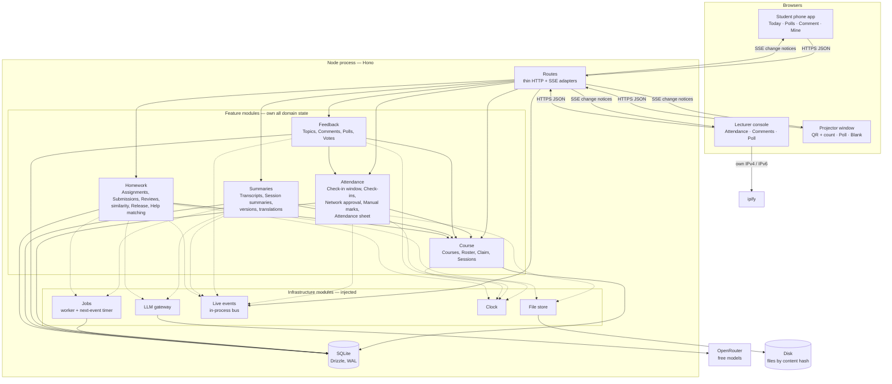
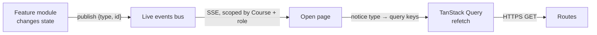
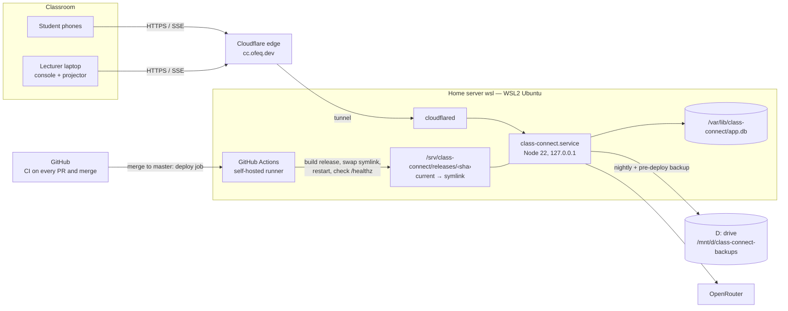

# Software components

The main components of Class Connect, how they fit together and where they run. Decided in [System architecture and components](https://github.com/ofeq-dev/class-connect/issues/10) and refined by later tickets on the [map](https://github.com/ofeq-dev/class-connect/issues/1). Terms follow [`GLOSSARY.md`](../GLOSSARY.md).

This page is the overview. The detail lives in:
- [Class diagram](diagrams/class-diagram.md): every module operation, the infrastructure interfaces with their real and fake adapters, and the tables each module owns.
- [Sequence diagrams](diagrams/sequence-diagrams.md): Claim → Check-in, a live Poll, Transcript → Session summary, review run → Release → Help matching.
- [Testing strategy](testing-strategy.md): what each component is tested through.

## Shape

One TypeScript package and one Node process. The server is Hono; it serves the JSON API, the SSE streams and the built front end. The front end is one React app built with Vite, with two surfaces that share types with the server through Hono's typed client.

```
src/
  server/<module>/      one folder per feature or infrastructure module
  client/student/       Student phone app
  client/lecturer/      Lecturer console and Projector window
  shared/               types shared by server and client
```

A lint rule on imports stops one module reaching into another's folder, so modules talk only through their interfaces.

## Component diagram



Solid arrows between feature modules are calls through the target's interface. Dotted arrows are injected infrastructure. The exact dependency set is in the [class diagram](diagrams/class-diagram.md#modules-and-their-interfaces).

## Feature modules

Each is a deep module: a small interface over the rules and the tables it owns. Routes call only these interfaces.

| Module | Responsibility | Key operations | Requirements |
|---|---|---|---|
| **Course** | Courses, the Roster, Claims and Sessions; resolves who is calling | `importRoster`, `addRosterEntry`, `findRosterEntry`, `claim`, `resetClaim`, `whoIs(token)`, Session create / read / update / delete | FR-ID-* |
| **Attendance** | The Check-in window, the block match, Pending check-ins, Network approval for one Session, Manual marks, the Attendance sheet | `openWindow`, `closeWindow`, `checkIn → Present \| Pending`, `approveNetwork`, `mark`, `sheet`, `exportXlsx`, `isPresent`, `nextMoment` | FR-ATT-* |
| **Feedback** | Topics, Comments with status and timing tags, Polls and Votes | `addTopic`, `renameTopic`, `archiveTopic`, `comment`, `setStatus`, `listComments`, `createPoll`, `openPoll`, `closePoll`, `vote`, `results(poll, viewer)`, `nextMoment` | FR-FB-* |
| **Summaries** | Transcripts, Session summaries with version history, publishing and translations | `uploadTranscript`, `generate`, `saveEdit`, `restore`, `publish`, `forStudent` | FR-SUM-* |
| **Homework** | Assignments and Criteria, Submissions, the review run, similarity, Release and Help matching | `setAssignment`, `submit`, `startReviewRun`, `retryReview`, `editReview`, `release`, `releaseReview`, `requestHelp`, `offerHelp`, `matchNow`, Lecturer and Student read models | FR-HW-* |

LLM prompts are **task** definitions that live in the feature module that uses them (`summarise`, `translate`, `reviewSubmission`, `classSummary`, `draftCriteria`).

## Infrastructure modules

Injected into the feature modules so that tests pass in fakes (see the [testing strategy](testing-strategy.md#the-test-harness)).

| Module | What it does | Real adapter | Fake |
|---|---|---|---|
| **LLM gateway** | `generate({task, input, schema})` → typed result or `LlmError`; `embed(texts)` | OpenRouter: fallback list of free models, per-task timeouts (3 min for summaries), schema validation with one fix-up retry, one call at a time (~15/min), `llm_usage` count against 1000/day | Scripted adapter (`LLM_ADAPTER=fake`), also used to rehearse the demo |
| **Jobs** | Durable background work and scheduled wake-ups | `job` table worked by one in-process worker, plus the next-event timer | `FakeJobs` (run due jobs on demand) |
| **Live events** | "Something changed" notices to open pages | In-process bus feeding one SSE stream per page, scoped by Course and role, heartbeat ~25 s | `RecordingEvents` |
| **Clock** | The only source of time | System time | `FakeClock` |
| **File store** | Uploaded files (Roster CSV, Transcripts, PDFs) | Files on disk under their content hash | `MemoryFileStore` |

## Cross-cutting mechanisms

### Identity

- **Lecturer:** one account; the password hash lives in server config, and a signed cookie keeps the Lecturer signed in. Courses carry a `lecturer_id` so real accounts can come in v2.
- **Student:** no account. A Claim sets a device-token cookie (`httpOnly`, `Secure`, `SameSite=Lax`, 400 days, refreshed each visit); only its hash is stored. `Course.whoIs(token)` resolves it on every request ([ADR 0002](adr/0002-no-student-accounts-roster-claim-and-device-binding.md)).

### Check-in and the network rule

The Session QR code encodes `https://cc.ofeq.dev/s/<code>`; loading it checks a claimed phone in. When the Lecturer opens the Check-in window, their browser reports its own IPv4 and IPv6 (from ipify). A Check-in from the same IPv4 `/24` or IPv6 `/64`, or from a block approved for this Session, is Present; any other is a Pending check-in until a Network approval. The client address comes from `CF-Connecting-IP`, which can be trusted because the app listens only on `127.0.0.1` behind the tunnel ([ADR 0001](adr/0001-qr-and-network-check-in-instead-of-photo-count.md), [ADR 0003](adr/0003-home-server-behind-cloudflare-tunnel.md)).

### Real time



- Notices carry no data (`{type: "poll.changed", id}`, `{type: "job.progress", id, done, total}`). The client maps each type to TanStack Query keys and refetches them, so the server's read models stay the only source of truth.
- After a reconnect, a page refetches everything. There is no backlog to replay.
- A heartbeat every ~25 s keeps Cloudflare from closing an idle stream.

### Time and background work

- **Time-dependent state is computed, not stored.** Whether a Poll is open, whether the Check-in window has passed midnight, whether a Submission is Late: all worked out from timestamps and the Clock when read.
- **The next-event timer** wakes at the earliest of Attendance's and Feedback's `nextMoment(after)` and the next job's `run_at`. It only sends notices or queues jobs; it never changes state. It recomputes after every wake, whenever a module reports a schedule change, and at boot.
- **The job table** (`kind, payload, run_at, status, attempts, progress, error`) is worked by one in-process worker. Kinds: `summary.generate`, `summary.translate`, `review.submission`, `review.compare`, `review.classSummary`, `help.match`.
- **The review run** is one `review.submission` job per Submission (3 attempts each, with Retry). The handler that settles the run's last job queues `review.compare`, then `review.classSummary`, in the same transaction. Progress is counted from job rows.
- **Restart recovery** ([#18](https://github.com/ofeq-dev/class-connect/issues/18)): at boot every `running` job returns to `queued`. A handler writes its result and marks the job done in one SQLite transaction, so a re-run is always safe. Attempts count when a job is claimed, so a job that keeps crashing the process ends `failed` instead of looping.

### Data

Drizzle ORM over `better-sqlite3` in WAL mode, with checked-in migrations applied at startup. Every table belongs to exactly one module; other modules reach its data only through the owner's interface. The tables per module are drawn in the [class diagram](diagrams/class-diagram.md#tables-each-module-owns). Uploaded files are stored on disk by content hash; their extracted text goes in the database.

## Deployment



- One systemd unit, `Restart=always`, environment from `/etc/class-connect.env` (OpenRouter key, `LLM_ADAPTER`).
- A merge to `master` passes `npm run check` on GitHub, then the self-hosted runner builds the commit into its own release directory, takes a backup, swaps the `current` symlink, restarts, and polls `/healthz` for the new SHA. If it doesn't appear within ~30 s, it rolls back. Migrations are additive only, so the previous release still runs after a rollback ([#19](https://github.com/ofeq-dev/class-connect/issues/19)).
- There is no fallback host: if the box is down, the app is down ([ADR 0003](adr/0003-home-server-behind-cloudflare-tunnel.md)).

## Front end

| Surface | Look | Structure |
|---|---|---|
| **Student phone app** | "Binder": lined paper, ring-binder tabs, a highlighter colour per tab; Bricolage Grotesque headings, Atkinson Hyperlegible body | Four bottom tabs: Today (yellow), Polls (pink), Comment (green), Mine (blue). Prototype: [`prototype/student-phone-app`](https://github.com/ofeq-dev/class-connect/tree/prototype/student-phone-app) |
| **Lecturer console** | Binder, carried over | Header with Projector control and ⋯ menu (Roster, Download attendance sheet, Diagnostics); three calm columns: Attendance, Comments, Poll. Prototype: [`prototype/lecturer-screens`](https://github.com/ofeq-dev/class-connect/tree/prototype/lecturer-screens) |
| **Projector window** | Large, public | QR code + live count, or the current Poll, or Blank; updated by the same Live events |

Front-end libraries: React, React Router (plain client-side routing), TanStack Query, `marked` + `DOMPurify` for Markdown preview.
