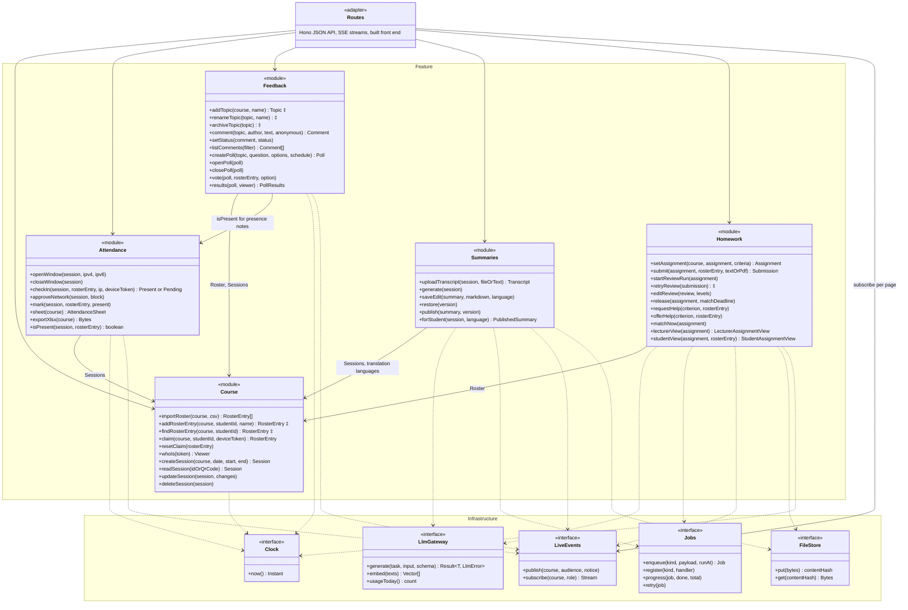
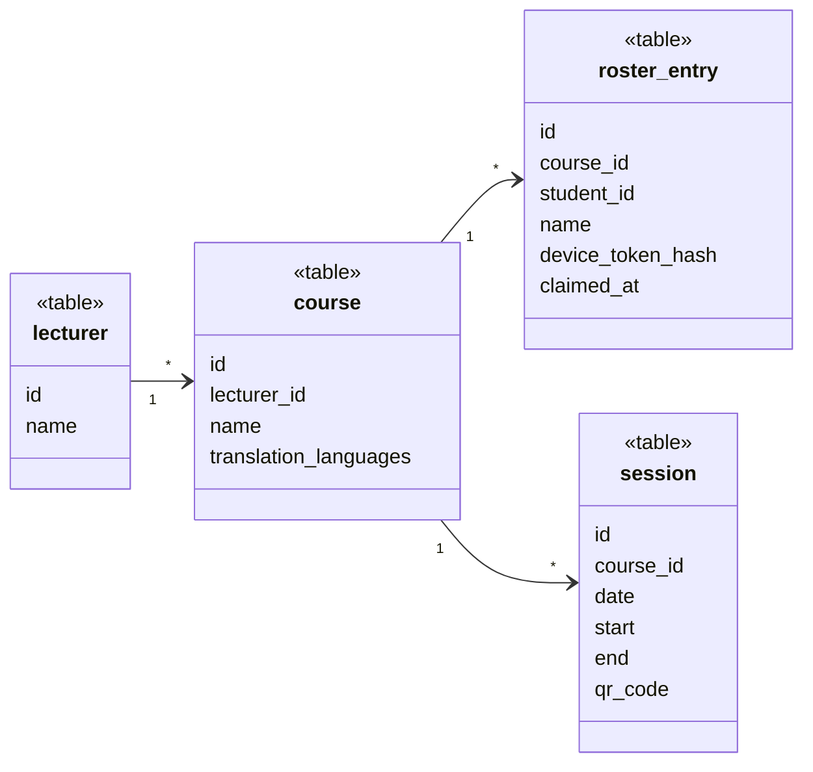
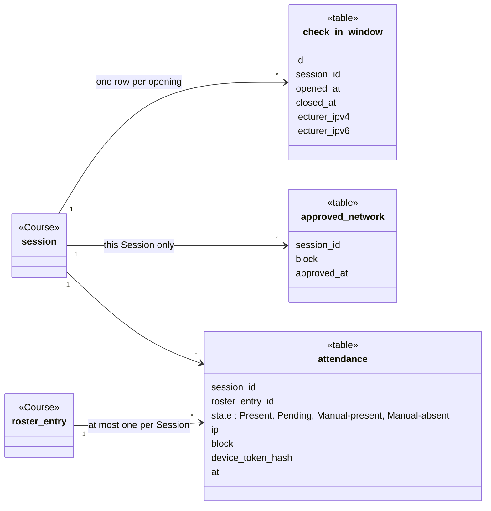
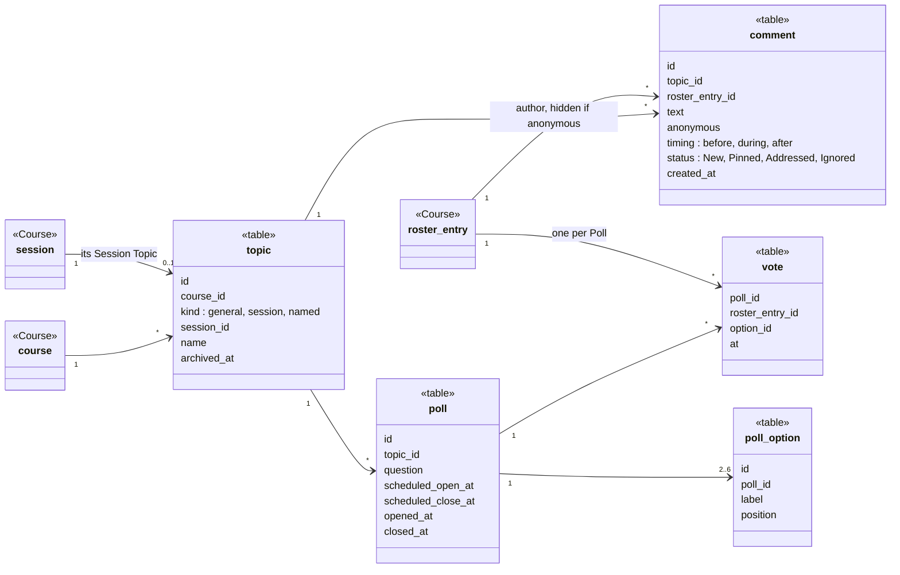
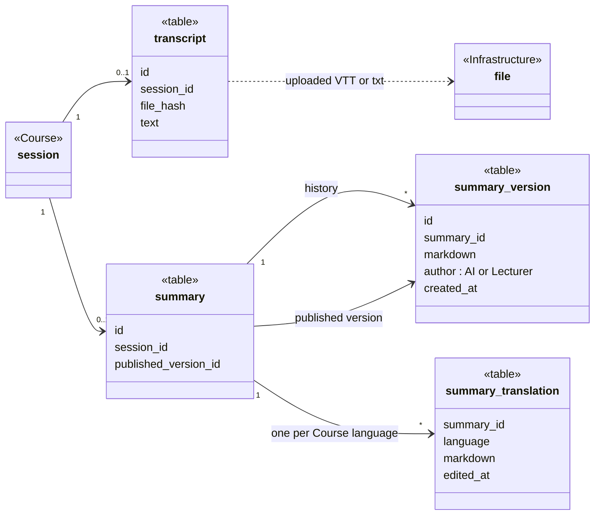
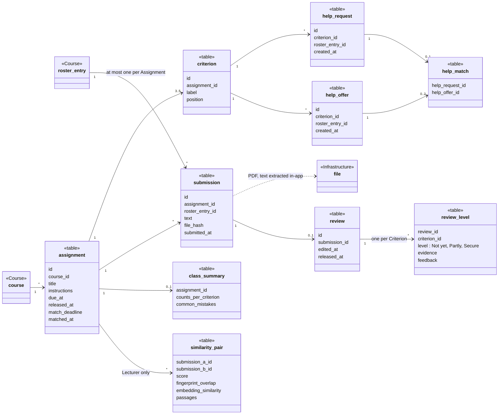
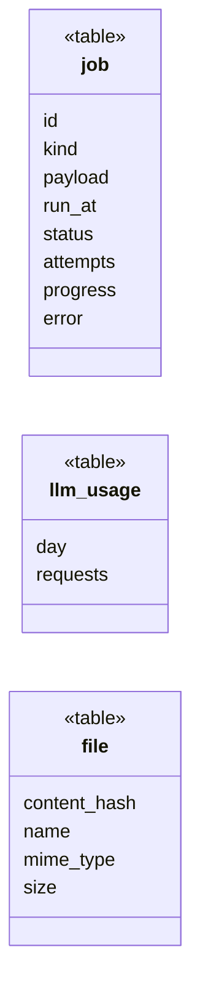

# Class diagram

Drawn from [System architecture and components](https://github.com/ofeq-dev/class-connect/issues/10). Terms follow [`GLOSSARY.md`](../../GLOSSARY.md).

The server is one Hono process. HTTP routes are thin adapters: they call only the module interfaces below. Five **feature modules** own all domain state. Five **infrastructure modules** are injected into them, so tests can pass in fakes.

Operations marked **‡** are not named in the architecture resolution. Each module needs one to do what was decided, so they are drawn here and listed in [Open seams found while drawing the diagrams](https://github.com/ofeq-dev/class-connect/issues/15).

## Modules and their interfaces

Solid arrows are calls between modules; dotted arrows are injected infrastructure. A lint rule on imports keeps a module out of another module's folder, so every solid arrow goes through the target's interface.

### Infrastructure adapters

| Interface | Real adapter | Test / rehearsal adapter |
|---|---|---|
| LLM gateway | OpenRouter: fallback list of free models, per-task timeouts, schema validation with one fix-up retry, one call at a time (~15/min), `llm_usage` count against 1000/day | scripted fake (`LLM_ADAPTER=fake`) |
| Jobs | durable `job` table worked by one in-process worker, plus the next-event timer | run-inline fake |
| Live events | in-process bus feeding one SSE stream per page (Course × role), heartbeat ~25 s | recording fake |
| Clock | system time | settable fake |
| File store | files on disk under their content hash | in-memory map |

LLM prompts are **task** definitions that live in each feature module (for example `summarise`, `translate`, `reviewSubmission`, `classSummary`, `draftCriteria`) and are passed to `LlmGateway.generate`.

## Tables each module owns

Drizzle over SQLite. A table belongs to exactly one module; other modules reach its data only through the owner's interface. Tables owned elsewhere are shown with their owner as the stereotype.

### Course

The Lecturer's password hash lives in server config, not in `lecturer`. A Claim reset clears `device_token_hash` and `claimed_at`; it never touches attendance.

### Attendance

`attendance` is overwritten so the latest action wins. Absent is not stored: no row, or a row still Pending once the Check-in window has closed (closed by the Lecturer or at midnight, worked out from the Clock), reads as Absent.

### Feedback

Whether a Poll is open is worked out from its scheduled and manual times and the Clock, latest action winning; it is never a stored flag.

### Summaries

### Homework

A Submission being Late is worked out from `submitted_at` and `due_at`, not stored.

### Infrastructure

Job kinds: `summary.generate`, `summary.translate`, `review.submission`, `review.compare`, `review.classSummary`, `help.match`.
