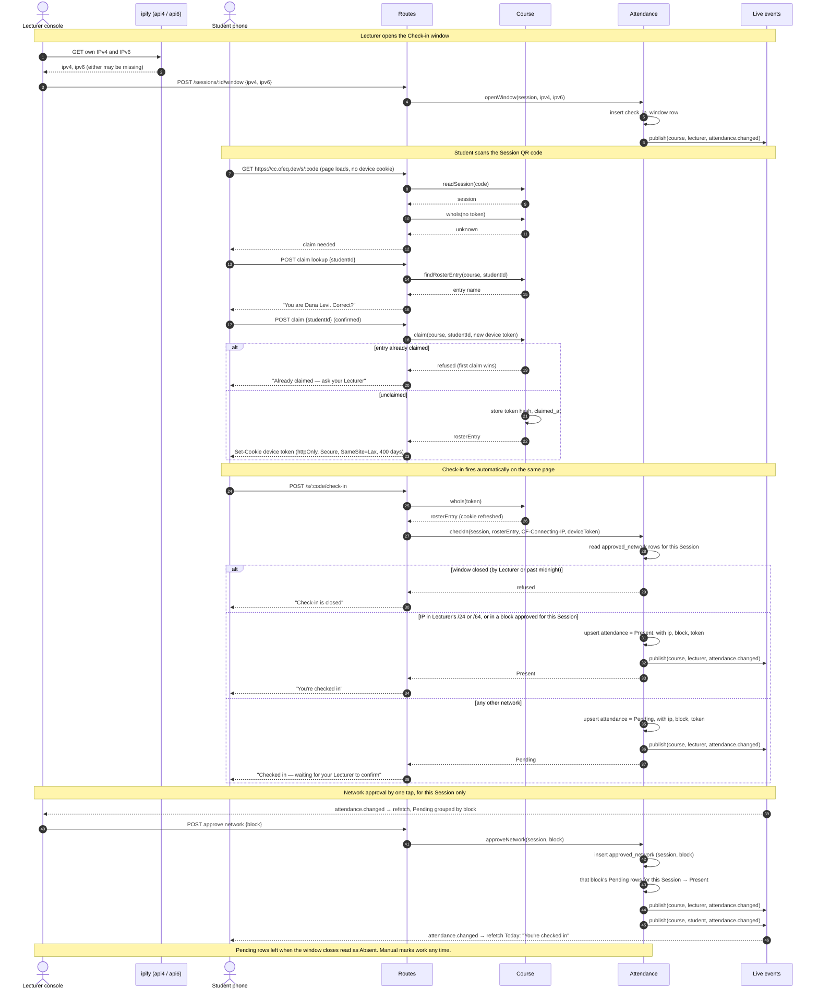
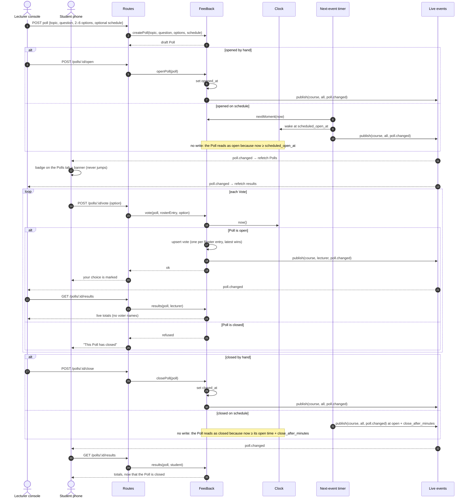
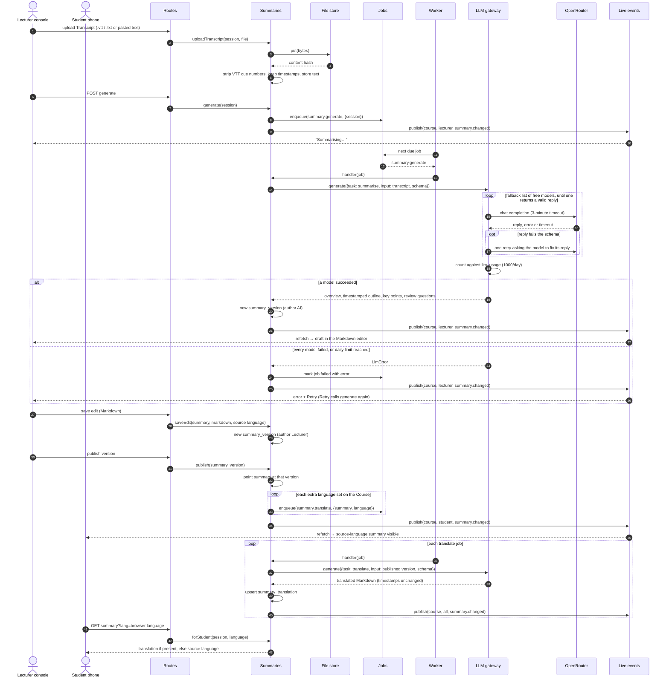
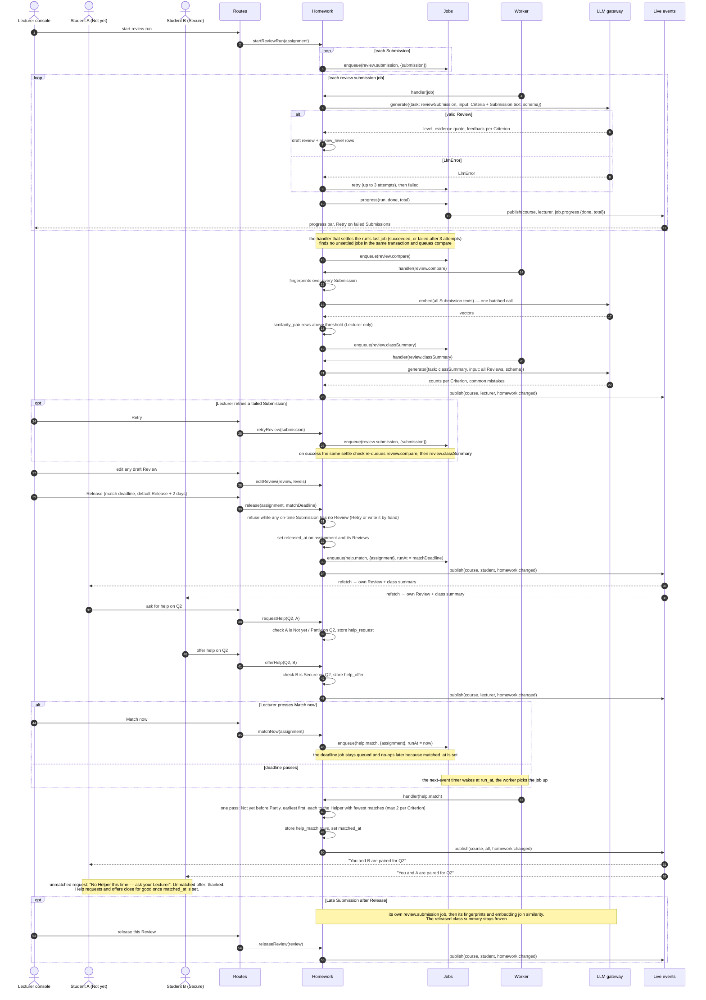

# Sequence diagrams

Four flows through the modules in the [class diagram](class-diagram.md), drawn from [System architecture and components](https://github.com/ofeq-dev/class-connect/issues/10). Terms follow [`GLOSSARY.md`](../../GLOSSARY.md).

Conventions in every diagram:

- **Routes** are the thin Hono adapters; they resolve the caller with `Course.whoIs(token)` and pass the result on. That lookup is left out after the first diagram.
- **Live events** carry change notices only (`{type, id}`), never data. On a notice, the client refetches the TanStack Query keys mapped to that type. Every page also refetches everything after its SSE stream reconnects.
- **Worker** is the one in-process worker draining the durable `job` table. The **next-event timer** wakes at the next scheduled moment and only sends notices or queues jobs; it never changes state.
- Scheduled moments (Poll open or close, Check-in window close) are not `job` rows. The timer asks each module for its `nextMoment(after)` and recomputes after every wake, and whenever a module reports a schedule change. Settled in [Open seams found while drawing the diagrams](https://github.com/ofeq-dev/class-connect/issues/15).

## 1. Claim, then Check-in

Covers the Check-in window opening, a first-time phone claiming its Roster entry and checking in in one flow, a Pending check-in, and Network approval by the Lecturer's tap for this Session.

## 2. A Poll opens and Votes arrive live

## 3. Transcript to a published Session summary

## 4. Homework review run through Release and Help matching

