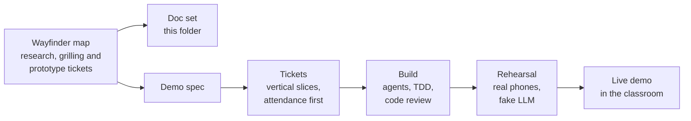

# Statement of Work

**Project:** Class Connect
**Client:** the course's teaching staff, who set the assignment
**Supplier:** the Lecturer-developer (solo), working with AI coding agents
**Repository:** [`ofeq-dev/class-connect`](https://github.com/ofeq-dev/class-connect)

Terms follow [`GLOSSARY.md`](../GLOSSARY.md). The problem and scope are in the [README](README.md).

## 1. Purpose

Design and demonstrate a simpler, LLM-ready set of teaching tools for a live Course. The assignment's weight is on **design** ("deep designing"): architecture, requirements and decisions. The build is done by AI agents ("vibe coding") from that design, reusing open-source modules.

## 2. Scope of work

The supplier will:

1. Decide the product and its architecture, recording each decision in GitHub Issues, [`GLOSSARY.md`](../GLOSSARY.md) and [`docs/adr/`](adr/).
2. Write the assignment doc set in `docs/` (section 4).
3. Turn the decisions into a buildable demo spec, then into tickets.
4. Build the demo with AI agents, test-first, through a reviewed pull-request flow.
5. Rehearse the demo on real phones and run it live in the classroom.

Feature priorities, in order. A lower tier never delays a higher one:

| Tier | Features | Finish |
|---|---|---|
| 1 | Check-in, Pending check-ins and Network approval, Manual marks, the live attendance view, the Attendance sheet | Polished |
| 2 | Comments (with quick reactions) and Polls | Simple |
| 3 | Session summaries and homework Reviews with Help matching | Minimal UI |

Out of scope: see [README § Out of scope](README.md#out-of-scope).

## 3. Approach

The work follows one path, tracked on the [wayfinder map](https://github.com/ofeq-dev/class-connect/issues/1):

- **Research tickets** (run by agents) answered the open technical questions: speech-to-text and summarisation, the hosting stack, homework review with free models.
- **Grilling tickets** settled each feature with the Lecturer-developer: joining a Course, the Attendance sheet, Comments and Polls, Session summaries, homework review, the architecture.
- **Prototype tickets** settled the two main screens with throwaway clickable prototypes: the [Student phone app](https://github.com/ofeq-dev/class-connect/issues/11) and the [Lecturer console](https://github.com/ofeq-dev/class-connect/issues/17).
- **Measurement**: the classroom Wi-Fi's public addresses were [measured in the room](https://github.com/ofeq-dev/class-connect/issues/12) before the Check-in rule was relied on.

**Build process** ([check and deploy pipeline](https://github.com/ofeq-dev/class-connect/issues/19)): agents branch from `dev` and open pull requests into `dev`. `npm run check` (type check, lint, tests) runs in GitHub Actions on every pull request. Only the Lecturer-developer merges `dev` into `master`, and every merge to `master` deploys to the home server through a self-hosted runner, with an automatic rollback if the health check fails.

## 4. Deliverables

| # | Deliverable | Location | State |
|---|---|---|---|
| D1 | Repository, problem and scope | [`README.md`](../README.md), [`docs/README.md`](README.md) | Done |
| D2 | Statement of Work | this document | Done |
| D3 | Software Requirements Specification | [`srs.md`](srs.md) | Done |
| D4 | Main use cases (client stories) | [`use-cases.md`](use-cases.md) | Done |
| D5 | Main software components | [`components.md`](components.md) | Done |
| D6 | Low-level class diagrams | [`diagrams/class-diagram.md`](diagrams/class-diagram.md) | Done |
| D7 | Sequence diagrams | [`diagrams/sequence-diagrams.md`](diagrams/sequence-diagrams.md) | Done |
| D8 | Testing strategy, addressing the classes | [`testing-strategy.md`](testing-strategy.md) | Done |
| D9 | Glossary and decision records | [`GLOSSARY.md`](../GLOSSARY.md), [`adr/`](adr/) | Done, kept current |
| D10 | Demo spec | GitHub issue, from the map | In progress |
| D11 | Working demo at `cc.ofeq.dev` | `src/`, deployed from `master` | After D10 |
| D12 | Live demo in the classroom | on classmates' phones | After D11 |

## 5. Milestones

The planning date for the live demo is the assignment's due date, 2026-11-30. The real class date is later; when it is known, M3–M7 move back with it. The short build changes no scope: a lower tier never delays a higher one, so tier 3 is what gets cut if time runs out.

| Milestone | Target | Exit criterion |
|---|---|---|
| M1 Decisions made | 2026-11-26 | Every map ticket closed except the demo spec |
| M2 Doc set submitted | 2026-11-30 | D1–D9 committed on `master` |
| M3 Demo spec ready | 2026-11-27 | D10 ready for `/to-spec`, including the seeded demo Course and the fake LLM's canned replies |
| M4 Tier 1 built | 2026-11-28 | Check-in to Attendance sheet works end to end on `cc.ofeq.dev` |
| M5 Tiers 2 and 3 built | 2026-11-29 | Comments, Polls, Session summaries and Reviews work on the demo path |
| M6 Rehearsed | 2026-11-29 evening | The [rehearsal script](testing-strategy.md#rehearsing-the-live-demo) passes on an iPhone and an Android phone, then one real-LLM dry run the day before |
| M7 Live demo | 2026-11-30 | Classmates check in, comment and vote live |

## 6. Roles

| Role | Who | Responsibilities |
|---|---|---|
| Lecturer-developer | the student doing the assignment | Makes every product decision, reviews and merges into `master`, owns the home server, supplies the OpenRouter key, measures the classroom network, runs the demo |
| AI agents | Claude Code and others | Research, prototypes, docs, implementation through pull requests into `dev`, code review |
| Classmates | the demo audience | Act as Students on their own phones during the live demo |

## 7. Assumptions

- The Lecturer opens the Check-in window from the classroom Wi-Fi, not mobile data (ADR 0001).
- Zoom provides a VTT Transcript for a recorded Session, so no speech-to-text is needed.
- OpenRouter's free models stay available, with 1000 requests a day after the 10 credits bought.
- The home server (`wsl`) and its Cloudflare Tunnel are up on demo day.
- Classmates' phones have a camera app that opens QR code links, and a current Safari or Chrome.

## 8. Constraints

- No paid services beyond the 10 OpenRouter credits already bought.
- Students install nothing and have no password.
- No integration with Zoom, Meet or Google Classroom.
- No fallback host.

## 9. Risks

| Risk | Effect | Mitigation |
|---|---|---|
| Home server or tunnel down during the demo | No demo | Rehearse on production; nightly and pre-deploy backups; automatic rollback on a failed deploy |
| Free LLM models slow, changed or rate-limited | Session summary or Review fails live | Fallback list of models, per-task timeouts, Retry; make the 90-minute Session summary before the demo and run a ~5-minute clip live; rehearse with `LLM_ADAPTER=fake` |
| Lecturer opens the window on mobile data | Carrier `/24` becomes the reference; anyone on that carrier block could check in | Accepted gap; open the window on the classroom Wi-Fi |
| Campus Wi-Fi hands out an address in a neighbouring `/24` on the day | Some Check-ins become Pending | One-tap Network approval for the Session; Manual marks |
| An absent Student pre-claims on a friend's phone | Friend checks in for them | Accepted gap (ADR 0002); each Check-in logs the device token |
| Cloudflare drops idle SSE connections | Screens stop updating | Heartbeat every ~25 s; refetch everything on reconnect |
| Scope creep in tiers 2 and 3 | Tier 1 not polished in time | Priority tiers; minimal UI for tier 3 |

## 10. Acceptance

The work is accepted when:

1. D1–D9 are on `master` and consistent with the map's decisions, the glossary and the ADRs.
2. In the classroom, a classmate's phone scanning the Session QR code claims and checks in with no further tap, and the Lecturer's console shows it live.
3. The Lecturer downloads an Attendance sheet showing every Roster entry against every Session.
4. A quick-reaction Comment and a Poll Vote from a phone reach the Lecturer console live, and the Poll's results appear on the phones when it closes.
5. A Session summary and a homework Review can be generated, edited and released on the demo path.
