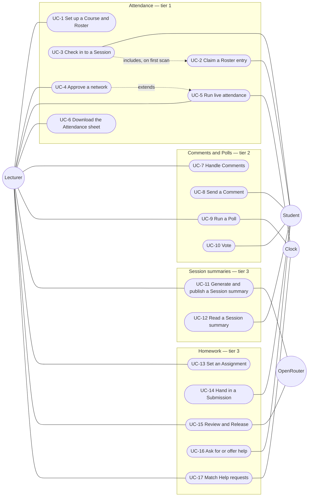

# Use cases

The main use cases and client stories for Class Connect. Terms follow [`GLOSSARY.md`](../GLOSSARY.md). Requirement IDs (`FR-…`, `NFR-…`) refer to the [SRS](srs.md); flows through the modules are drawn in the [sequence diagrams](diagrams/sequence-diagrams.md).

## Actors

| Actor | Kind | Description |
|---|---|---|
| **Lecturer** | Primary | Runs Courses and Sessions from the Lecturer console on a laptop. One account. |
| **Student** | Primary | On a Course's Roster; uses the Student phone app. No account: recognised by the phone they Claimed from. |
| **Classroom audience** | Secondary | Sees the Projector window. |
| **Clock** | System | Scheduled moments: a Poll opening or closing, the Check-in window closing at midnight, the Help match deadline. |
| **OpenRouter** | External | Free LLM models for Session summaries, translations, Reviews and the class summary. |

## Use-case map

## Client stories

The brief's features as stories, each pointing at its use case.

**Attendance**
- As a Lecturer, I want every Student on my Roster listed in one spreadsheet against every Session, so that I can hand in attendance without retyping it. → UC-6
- As a Student, I want to check in by pointing my camera at the screen, so that it takes no effort. → UC-2, UC-3
- As a Lecturer, I want a link forwarded to someone at home not to count, so that attendance means presence. → UC-3, UC-4
- As a Lecturer, I want to fix any Student's attendance at any time, so that a dead phone or a late arrival is never a problem. → UC-5

**Comments and Polls**
- As a Student, I want to tell the Lecturer "too fast" with one tap, anonymously if I like, so that I speak up without interrupting. → UC-8
- As a Student, I want to send a thought after the Session, so that I can raise it once I've had time to think. → UC-8
- As a Lecturer, I want quick reactions grouped with counts, so that I can see the room at a glance while teaching. → UC-7
- As a Lecturer, I want to put a quick question to the room and show the results on the projector, so that I can check understanding on the spot. → UC-9, UC-10

**Session summaries**
- As a Lecturer, I want a summary of the Session made from its Zoom Transcript, which I can correct before Students see it, so that I don't write notes by hand. → UC-11
- As a Student, I want the Session summary in my own language, so that I can revise from it. → UC-12

**Homework**
- As a Lecturer, I want a first-draft Review of every Submission against my Criteria, so that I spend my time correcting, not writing. → UC-15
- As a Lecturer, I want to see which Submissions look copied or paraphrased from each other, so that I can follow it up myself. → UC-15
- As a Student, I want to see how the other Students did on each Criterion without seeing anyone's work, so that I know where I stand. → UC-15
- As a Student who struggled with a question, I want to be paired with a classmate who got it, without either of us exposing our levels, so that I can get help. → UC-16, UC-17

## Use cases

### UC-1 Set up a Course and Roster

| | |
|---|---|
| **Actor** | Lecturer |
| **Goal** | A Course with its Roster and Sessions, ready for Check-ins |
| **Requirements** | FR-ID-1 – FR-ID-3, FR-ID-7, FR-FB-1 |

**Main flow**
1. The Lecturer signs in with the configured password.
2. The Lecturer creates a Course and imports a Roster CSV of names and student IDs.
3. The app shows one Roster entry per row and reports any bad rows.
4. The Lecturer creates the Course's Sessions, each with a date and a start and end time. Each Session gets its QR code and its own Topic.

**Alternative flows**
- 3a. A Student is missing from the CSV: the Lecturer adds them by hand.
- 3b. The CSV is imported again: existing student IDs are not duplicated.
- *Any time.* A Student has a new phone or cleared their browser: the Lecturer opens the Roster from the ⋯ menu and taps Claim reset. The Student can Claim again at once; their attendance is untouched.

### UC-2 Claim a Roster entry

| | |
|---|---|
| **Actor** | Student |
| **Goal** | The Student's phone is bound to their Roster entry |
| **Precondition** | The Student is on the Roster and their phone has no Claim |
| **Requirements** | FR-ID-4 – FR-ID-6, FR-ID-8 |
| **Sequence** | [Claim, then Check-in](diagrams/sequence-diagrams.md#1-claim-then-check-in) |

**Main flow**
1. The Student opens the Session's QR code link for the first time.
2. The app asks for their student ID.
3. The app shows "You are <name>. Correct?".
4. The Student confirms. The app binds the entry to this phone with a long-lived device token.
5. The flow continues straight into UC-3.

**Alternative flows**
- 3a. The student ID isn't on the Roster: the app refuses and the Student asks the Lecturer.
- 4a. The entry is already claimed: the app refuses ("Already claimed — ask your Lecturer"). The first Claim wins.
- 4b. This phone already claimed another entry: the app refuses. One phone per Student.

**Known gap (ADR 0002):** an absent Student could Claim on a friend's phone in advance. Each Check-in logs the device token as evidence.

### UC-3 Check in to a Session

| | |
|---|---|
| **Actor** | Student |
| **Goal** | The Student is counted Present for the Session |
| **Precondition** | The Check-in window is open; the phone has a Claim (else UC-2 first) |
| **Requirements** | FR-ATT-1, FR-ATT-4 – FR-ATT-6, FR-ATT-10, FR-ATT-12, FR-SA-2, NFR-1 |
| **Sequence** | [Claim, then Check-in](diagrams/sequence-diagrams.md#1-claim-then-check-in) |

**Main flow**
1. The Student scans the QR code on the projector with their camera app.
2. The link opens and the app checks them in with no tap.
3. The Student's address is in the Lecturer's `/24`, so the Check-in counts as Present.
4. Today shows "Checked in at 10:18". The Lecturer's count goes up live.

**Alternative flows**
- 3a. The Student is on another network (mobile data, another Wi-Fi): the Check-in is a Pending check-in and Today shows "Checked in — waiting for your Lecturer to confirm". It becomes Present on a Network approval (UC-4), or reads as Absent if the window closes first.
- 2a. The window is closed: the Check-in is refused, and Today tells the Student to ask the Lecturer to mark them present (UC-5).

### UC-4 Approve a network

| | |
|---|---|
| **Actor** | Lecturer |
| **Goal** | Pending check-ins from a network the Lecturer trusts count as Present |
| **Requirements** | FR-ATT-7, FR-ATT-8, FR-LC-3, FR-LC-6 |

**Main flow**
1. The Attendance column shows an orange card: "2 Students checked in from another network (Ariel, Neta)".
2. The Lecturer sees the named Students in the room and taps **Approve network**.
3. Those Pending check-ins become Present, and so does any later Check-in from that network in this Session.
4. The Students' Today tab updates to checked in.

**Alternative flows**
- 2a. The Lecturer doesn't recognise the Students: they leave it. Those Check-ins read as Absent when the window closes.

**Rule:** the approval is for this Session only. Next Session starts again from the Lecturer's own network.

### UC-5 Run live attendance

| | |
|---|---|
| **Actors** | Lecturer; Clock |
| **Goal** | An accurate attendance record for the Session |
| **Requirements** | FR-ATT-2, FR-ATT-3, FR-ATT-9, FR-ATT-11, FR-ATT-13, FR-LC-1 – FR-LC-3, FR-LC-7 |

**Main flow**
1. On the classroom Wi-Fi, the Lecturer opens the Session in the console and opens the Check-in window. The browser reports the Lecturer's public addresses.
2. The Lecturer shows the QR code and live count on the Projector window, opened from the Course's projector link on the laptop's second display or on a classroom PC.
3. Students check in (UC-3); the console shows "19 of 32 present" and the lists live.
4. The Lecturer closes the window (or leaves it; it closes at midnight).

**Alternative flows**
- *Any time.* A Student can't check in (dead phone, late, window closed): the Lecturer expands "Who's here" and taps ✓ to Manual mark them present. ✕ marks a Student absent, even one who checked in. Undo is offered.
- *Any time after a ✕.* The Student scans anyway: their Check-in is a Held scan. They stay Absent, their phone shows "Checked in — waiting for your Lecturer to confirm", and a popup on the console names them with **Allow** and **Keep absent**. Allow makes them Present from the time they scanned; Keep absent leaves the ✕. If the Lecturer closes the popup or ignores it, the Student stays listed beside the Pending check-ins, and can still be allowed after class.
- 4a. The Lecturer reopens the window later: earlier Check-ins are kept and the addresses are captured again.

### UC-6 Download the Attendance sheet

| | |
|---|---|
| **Actor** | Lecturer |
| **Goal** | The Course's attendance as an xlsx file |
| **Requirements** | FR-ATT-14 |

**Main flow**
1. The Lecturer picks **Download attendance sheet** from the ⋯ menu.
2. The app returns one xlsx: every Roster entry against every Session, each cell Present, Manual or Absent, with per-Student totals and a per-Session headcount.

### UC-7 Handle Comments

| | |
|---|---|
| **Actor** | Lecturer |
| **Goal** | Respond to what the room is saying without breaking the flow of teaching |
| **Requirements** | FR-FB-3 – FR-FB-7, FR-FB-9, FR-LC-4 |

**Main flow**
1. Comments arrive live in the Comments column, newest first, with Pinned ones on top.
2. Quick reactions are grouped ("×4 Too fast", with a time range).
3. The Lecturer answers aloud, then marks the Comment or group ✓ Addressed or ✕ Ignored. It folds under "Dealt with (n)".

**Alternative flows**
- 3a. The Lecturer pins a Comment to come back to; it stays on top in every later Session until Addressed.
- 1a. The Lecturer filters by a Topic chip (e.g. "Assignment 2") or opens the all-Comments screen to filter by Student, status or before / during / after.
- *Any.* An anonymous Comment shows no author, but on a Session Topic it still shows whether its author checked in.

### UC-8 Send a Comment

| | |
|---|---|
| **Actor** | Student |
| **Goal** | Tell the Lecturer something, now or later |
| **Requirements** | FR-FB-2 – FR-FB-5, FR-FB-8, FR-FB-9, FR-SA-1 |

**Main flow**
1. On the Comment tab, the Student picks a Topic (the current Session by default).
2. They tap a quick reaction ("Too fast"). It is sent at once, with Undo.
3. The Comment appears on the Mine tab with status New.

**Alternative flows**
- 2a. The Student types a Comment and taps Send.
- 2b. The Student turns on the anonymous switch first.
- 3a. The Student deletes the Comment while it is still New.
- *Any time.* After the Session, the Student comments on the Session's Topic; it is tagged "after".

### UC-9 Run a Poll

| | |
|---|---|
| **Actors** | Lecturer; Clock |
| **Goal** | A quick read of the room on the current material |
| **Requirements** | FR-FB-10, FR-FB-11, FR-FB-13, FR-LC-5, FR-LC-7 |
| **Sequence** | [A Poll opens and Votes arrive live](diagrams/sequence-diagrams.md#2-a-poll-opens-and-votes-arrive-live) |

**Main flow**
1. The Lecturer taps **+ New poll**, types a question and 2–6 options, and chooses "Opens now".
2. The Lecturer taps **Show on projector**. Live totals appear on the console only.
3. The Lecturer taps **Close and show results**. The projector and the phones show the results.
4. The Lecturer taps **Done**.

**Alternative flows**
- 1a. The Poll is prepared in advance, to open at a set time and/or close after N minutes. The Clock opens and closes it.
- 1b. "Later" saves an incomplete draft; it can't open until it has a question and two options.
- 3a. A closed Poll can't reopen; the Lecturer copies it.

### UC-10 Vote

| | |
|---|---|
| **Actor** | Student |
| **Goal** | Answer the Lecturer's Poll |
| **Requirements** | FR-FB-12 – FR-FB-14, FR-SA-1, NFR-1 |

**Main flow**
1. A Poll opens; the Polls tab shows a badge and a "New poll: …" banner appears.
2. The Student opens it and taps an option. That tap is the Vote.
3. When the Poll closes, the Student sees the totals.

**Alternative flows**
- 2a. The Student taps another option while the Poll is open; the Vote changes.
- 2b. The Poll has closed: the Vote is refused.

### UC-11 Generate and publish a Session summary

| | |
|---|---|
| **Actors** | Lecturer; OpenRouter |
| **Goal** | Students get a reviewed summary of the Session |
| **Requirements** | FR-SUM-1 – FR-SUM-7 |
| **Sequence** | [Transcript to a published Session summary](diagrams/sequence-diagrams.md#3-transcript-to-a-published-session-summary) |

**Main flow**
1. After the Session, the Lecturer uploads the Zoom `.vtt` Transcript for it.
2. The Lecturer taps Generate; the Session shows "Summarising…".
3. The summary arrives: overview, timestamped outline, key points, review questions.
4. The Lecturer corrects it in the Markdown editor and saves; each save is a version.
5. The Lecturer publishes. Students can now see it, and translations into the Course's languages are made.

**Alternative flows**
- 1a. The Transcript has no timestamps (a `.txt` or pasted text): it is accepted with a warning, and the outline has no times.
- 3a. Every model fails or the daily limit is hit: an error and Retry are shown.
- 4a. The Lecturer restores an earlier version; it becomes the newest.
- 4b. The Lecturer regenerates, after confirming; a new AI version is added.
- 5a. The Lecturer edits a translation; publishing again replaces translation edits, after a confirm.

### UC-12 Read a Session summary

| | |
|---|---|
| **Actor** | Student |
| **Goal** | Revise a Session |
| **Requirements** | FR-SUM-6, FR-SUM-8, FR-SUM-9 |

**Main flow**
1. The Student opens the published Session summary.
2. It is shown in their browser's language if a translation exists, else in the Transcript's language.
3. The Student may switch language.

**Where:** Today → Session summaries, then the summary's sub-page.

### UC-13 Set an Assignment

| | |
|---|---|
| **Actors** | Lecturer; OpenRouter |
| **Goal** | An Assignment Students can hand in to, with Criteria to judge it on |
| **Requirements** | FR-HW-1 |

**Main flow**
1. The Lecturer creates an Assignment with instructions and a due date.
2. The Lecturer writes 3–5 Criteria (a question such as "Q2", or a skill).

**Alternative flows**
- 2a. The Lecturer asks the LLM to draft the Criteria, then edits them.

### UC-14 Hand in a Submission

| | |
|---|---|
| **Actor** | Student |
| **Goal** | The Student's work is handed in for review |
| **Requirements** | FR-HW-2 |

**Main flow**
1. The Student pastes their text or uploads a PDF before the due date.

**Alternative flows**
- 1a. The Student replaces their Submission; before the due date only the latest counts.
- 1b. After the due date the Submission is still accepted and marked Late.

**Where:** Today → Assignments, then the Assignment's sub-page.

### UC-15 Review and Release

| | |
|---|---|
| **Actors** | Lecturer; OpenRouter |
| **Goal** | Every Student gets a checked Review; the Lecturer sees similarities |
| **Requirements** | FR-HW-3 – FR-HW-10 |
| **Sequence** | [Homework review run through Release and Help matching](diagrams/sequence-diagrams.md#4-homework-review-run-through-release-and-help-matching) |

**Main flow**
1. After the due date, the Lecturer starts the review run and watches its progress.
2. Each Submission gets a draft Review: a level, an evidence quote and feedback per Criterion.
3. The app then finds similar Submission pairs and writes the class summary.
4. The Lecturer checks the similarity pairs and edits any draft Review.
5. The Lecturer taps Release, setting the match deadline (default 2 days).
6. Each Student sees their own Review and the anonymised class summary; Help requests and offers open.

**Alternative flows**
- 2a. A Submission's review fails 3 times: it shows Retry. The rest of the run carries on; a successful Retry recomputes similarity and the class summary.
- 5a. An on-time Submission has no Review: Release is refused until the Lecturer retries it or writes the Review by hand.
- *After Release.* A Late Submission is reviewed, joins similarity, and its Review is released on its own. The class summary stays as released.

### UC-16 Ask for or offer help

| | |
|---|---|
| **Actor** | Student |
| **Goal** | Get help from, or give help to, a classmate on one Criterion |
| **Precondition** | The Assignment is released and Help matching hasn't run |
| **Requirements** | FR-HW-11, FR-HW-13 |

**Main flow**
1. A Student at Not yet or Partly on Q2 taps "Ask for help with Q2".
2. Another Student at Secure on Q2 taps "Offer to help with Q2".
3. Neither knows who else has asked or offered. They wait for the match (UC-17).

**Where:** the Assignment's sub-page on Today, under the Student's own Review.

### UC-17 Match Help requests

| | |
|---|---|
| **Actors** | Clock or Lecturer |
| **Goal** | Pair Help requests with Helpers |
| **Requirements** | FR-HW-12 – FR-HW-14 |

**Main flow**
1. The match deadline passes.
2. The app matches in one pass: Not yet before Partly, earliest first, each to the Helper with the fewest matches, at most 2 per Helper per Criterion.
3. Matched Students see "You and X are paired for Q2". An unmatched request sees "No Helper this time — ask your Lecturer"; an unmatched offer is thanked.
4. Help requests and offers close.

**Alternative flows**
- 1a. The Lecturer presses Match now before the deadline. The pass runs at once; the deadline later does nothing.
